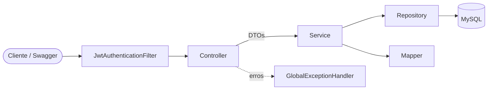
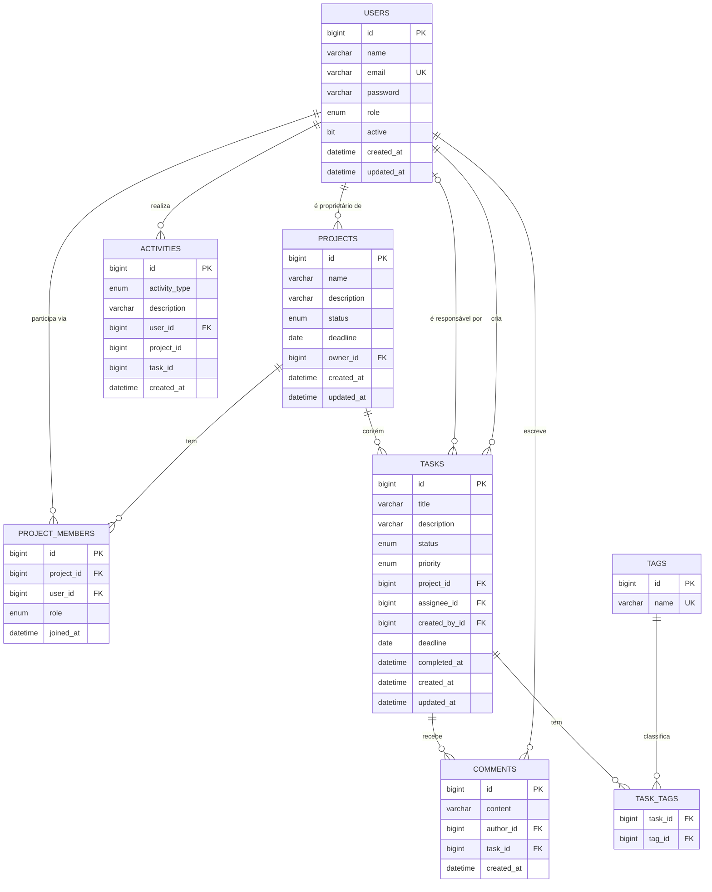

# DevFlow

> Um projeto de portfólio feito para organizar projetos e tarefas de desenvolvimento, usando **Java 21 + Spring Boot**.


## Sobre o projeto

O **DevFlow** nasceu como um projeto de portfólio para colocar em prática conceitos de desenvolvimento de APIs com Java e Spring Boot. A ideia é reunir, em um só lugar, recursos que ajudam uma equipe a organizar projetos, dividir tarefas, trocar comentários e acompanhar o andamento do trabalho.

As tarefas passam por etapas como `TODO`, `EM_ANDAMENTO`, `EM_REVISAO` e `CONCLUIDA`. O sistema também mantém um histórico de atividades e apresenta estatísticas para facilitar o acompanhamento dos projetos.

## Objetivo

O principal objetivo é aprender construindo: aplicar os conceitos estudados em um projeto mais completo, desde a modelagem do banco de dados até a criação, segurança, documentação e testes da API. Além das operações básicas de cadastro, o DevFlow trabalha com regras de negócio e controle de acesso, aproximando o projeto de situações que podem aparecer em aplicações reais.

## Funcionalidades

- **Autenticação**: cadastro, login, senha criptografada (BCrypt), JWT, papéis `USER` e `ADMIN`, validação de dados.
- **Usuários**: perfil com estatísticas, atualizar dados, alterar senha, desativar conta (exclusão lógica), histórico de atividades.
- **Projetos**: criar, editar, excluir, listar (filtros, ordenação e paginação), membros, transferência de propriedade, status e prazo, **percentual de conclusão automático**.
- **Tarefas**: título, descrição, status, prioridade, responsável, prazo, data de conclusão e tags; filtros por status, prioridade, responsável, tag, texto e atrasadas.
- **Comentários**: comentários por tarefa, com autor e data/hora.
- **Atividades**: histórico automático (projeto criado, tarefa concluída, membro adicionado, comentário etc.).
- **Dashboard**: totais de projetos e tarefas, tarefas atrasadas, tarefas por prioridade e status, produtividade por usuário.
- **Administração**: listar, ativar e desativar usuários (somente `ADMIN`).

### Algumas regras de negócio

Além das funcionalidades principais, o projeto inclui regras para manter os dados consistentes e evitar ações sem permissão:

| Regra | Onde está |
|---|---|
| Só edita o projeto quem participa dele (ou é proprietário/admin) | `ProjectAccessService` |
| Só o proprietário (ou admin) exclui o projeto e gerencia membros | `ProjectAccessService` |
| Um usuário não entra duas vezes no mesmo projeto | `ProjectService` + constraint única `uk_project_member` |
| Usuário desativado não faz login (e o token antigo deixa de valer) | `AuthService` + `JwtAuthenticationFilter` |
| Tarefa não pode ser concluída sem responsável | `TaskService.applyStatus` |
| Responsável precisa ser membro ativo do projeto | `TaskService.resolveAssignee` |
| Prazos inválidos: não podem estar no passado; tarefa não pode passar do prazo do projeto | `TaskService` / `ProjectService` |
| Tarefa atrasada = prazo vencido e não concluída (calculado automaticamente) | `Task.isOverdue()` + filtro `overdue=true` |
| Percentual de conclusão = tarefas concluídas ÷ total de tarefas | `ProgressCalculator` |
| Todas as tarefas concluídas → projeto passa a `CONCLUIDO`; reabrir tarefa → volta a `EM_ANDAMENTO` | `TaskService.syncProjectStatus` |
| Projeto só pode ser concluído manualmente sem tarefas pendentes | `ProjectService.update` |
| Remover um membro deixa as tarefas dele sem responsável | `ProjectService.removeMember` |
| O proprietário não pode ser removido; o admin não pode desativar a própria conta | `ProjectService` / `UserService` |
| Toda entrada da API é validada (Bean Validation) | DTOs + `GlobalExceptionHandler` |

## Tecnologias utilizadas

| Camada | Tecnologia |
|---|---|
| Linguagem | Java 21 |
| Framework | Spring Boot 3.5 (Web, Data JPA, Security, Validation) |
| Autenticação | JWT (jjwt 0.12) + BCrypt |
| Banco de dados | MySQL 8 (H2 em memória nos testes) |
| Documentação | Swagger / OpenAPI (springdoc) |
| Build | Maven |
| Testes | JUnit 5, Mockito, AssertJ, MockMvc |
| Infraestrutura | Docker e Docker Compose |
| Produtividade | Lombok |

## Arquitetura

Arquitetura em camadas, com responsabilidades bem separadas:



| Pacote | Responsabilidade |
|---|---|
| `controller` | Recebe a requisição HTTP, valida com `@Valid`, **delega ao service** e devolve o DTO. Nenhuma regra de negócio. |
| `service` | Regras de negócio, permissões, transações e registro de atividades. |
| `repository` | Acesso a dados (Spring Data JPA) e consultas agregadas. |
| `specification` | Filtros dinâmicos (JPA Specifications) para listagens. |
| `entity` / `enums` | Modelo de domínio e enumerações. |
| `dto` | Objetos de entrada e saída da API (`record`s com validações). |
| `mapper` | Conversão entidade ↔ DTO. |
| `security` | JWT, filtro de autenticação, `UserDetails`, handlers 401/403. |
| `exception` | Exceções de negócio e tratamento global com `@RestControllerAdvice`. |
| `config` | Segurança, OpenAPI e criação do administrador inicial. |

### Estrutura de pastas

```
devflow-api
├── src/main/java/com/devflow
│   ├── config/          SecurityConfig, OpenApiConfig, AdminInitializer
│   ├── controller/      Auth, User, AdminUser, Project, Task, Comment, Dashboard
│   ├── dto/             auth, user, project, task, comment, activity, dashboard, common
│   ├── entity/          User, Project, ProjectMember, Task, Tag, Comment, Activity
│   ├── enums/           Role, ProjectStatus, TaskStatus, TaskPriority, ActivityType...
│   ├── exception/       exceções de negócio + GlobalExceptionHandler
│   ├── mapper/          UserMapper, ProjectMapper, TaskMapper...
│   ├── repository/      interfaces Spring Data JPA
│   ├── security/        JwtService, JwtAuthenticationFilter, CustomUserDetails...
│   ├── service/         regras de negócio
│   ├── specification/   filtros dinâmicos
│   └── util/            ProgressCalculator
├── src/main/resources/application.yml
├── src/test/java/com/devflow   testes unitários e de integração
├── docs/schema.sql             DDL de referência do banco
├── Dockerfile
├── docker-compose.yml
├── .env.example
└── pom.xml
```

## Banco de dados

### Diagrama



### Relacionamentos entre as entidades

| Relacionamento | Tipo | Explicação |
|---|---|---|
| `User` → `Project` (owner) | 1:N | Um usuário pode ser proprietário de vários projetos; cada projeto tem exatamente um proprietário. |
| `User` ↔ `Project` (via `ProjectMember`) | **N:N** | Um usuário participa de vários projetos e um projeto tem vários membros. A tabela associativa `project_members` guarda o papel (`OWNER`/`MEMBER`) e a data de entrada — por isso é uma entidade. A constraint `uk_project_member (project_id, user_id)` impede duplicidade. |
| `Project` → `Task` | 1:N | Um projeto tem várias tarefas; toda tarefa pertence a um projeto (excluir o projeto exclui as tarefas em cascata). |
| `User` → `Task` (assignee) | 1:N | Um usuário pode ser responsável por várias tarefas; a tarefa pode estar sem responsável (FK opcional). |
| `User` → `Task` (created_by) | 1:N | Registra quem criou a tarefa. |
| `Task` ↔ `Tag` (via `task_tags`) | **N:N** | Uma tarefa tem várias tags e uma tag pode ser usada em várias tarefas. |
| `Task` → `Comment` | 1:N | Uma tarefa tem vários comentários (excluídos junto com a tarefa). |
| `User` → `Comment` | 1:N | Um usuário escreve vários comentários. |
| `User` → `Activity` | 1:N | Cada atividade registra quem a realizou. |
| `Activity` → `Project`/`Task` | referência "soft" | `project_id` e `task_id` são colunas indexadas **sem FK**, de propósito: o histórico precisa sobreviver à exclusão do projeto ou da tarefa. |

**Índices**: `projects(status)`, `projects(owner_id)`, `project_members(user_id)`, `tasks(project_id)`,
`tasks(assignee_id)`, `tasks(status)`, `tasks(deadline)`, `comments(task_id)`, `activities(user_id)`,
`activities(project_id)`, `activities(created_at)` — além dos índices das chaves únicas.

O arquivo [`docs/schema.sql`](docs/schema.sql) traz o DDL de referência completo (com CHECKs).
Em desenvolvimento, o Hibernate cria/atualiza as tabelas sozinho (`ddl-auto=update`).

## Como executar

### Pré-requisitos

- JDK 21
- Maven 3.9+
- MySQL 8 (ou Docker)

### Executando localmente

1. **Banco**: crie o banco no MySQL (o app também tenta criá-lo automaticamente):

   ```sql
   CREATE DATABASE devflow CHARACTER SET utf8mb4;
   ```

2. **Variáveis de ambiente** (todas têm valor padrão para desenvolvimento, mas ajuste o usuário/senha do MySQL):

   | Variável | Padrão | Descrição |
   |---|---|---|
   | `DB_URL` | `jdbc:mysql://localhost:3306/devflow?...` | URL JDBC |
   | `DB_USERNAME` | `root` | Usuário do banco |
   | `DB_PASSWORD` | `root` | Senha do banco |
   | `JWT_SECRET` | valor de desenvolvimento | Segredo do JWT (mín. 32 caracteres) — **troque em produção** |
   | `JWT_EXPIRATION_MS` | `86400000` | Validade do token (24 h) |
   | `ADMIN_EMAIL` / `ADMIN_PASSWORD` | vazio | Se informados, cria um administrador na primeira execução |

3. **Rodar**:

   ```bash
   export DB_USERNAME=root DB_PASSWORD=sua_senha
   export ADMIN_EMAIL=admin@devflow.com ADMIN_PASSWORD=Admin1234
   mvn spring-boot:run
   ```

4. Acesse o Swagger: <http://localhost:8080/swagger-ui.html>

### Executando com Docker

```bash
cp .env.example .env        # edite o .env e troque TODAS as senhas e o JWT_SECRET
docker compose up --build -d
docker compose logs -f app  # acompanhe a inicialização
```

- API: <http://localhost:8080> · Swagger: <http://localhost:8080/swagger-ui.html>
- MySQL exposto em `localhost:3307` (dentro do Docker a API usa `db:3306`)
- Parar: `docker compose down` (adicione `-v` para apagar também os dados do banco)

> O arquivo `.env` está no `.gitignore`. Só o `.env.example` (sem senhas reais) vai para o GitHub.

## Como usar a API

1. Cadastre-se e faça login em `/api/auth/*`.
2. No Swagger, clique em **Authorize** e cole o token. Via `curl`, envie `Authorization: Bearer <token>`.

```bash
# cadastro
curl -X POST http://localhost:8080/api/auth/register \
  -H "Content-Type: application/json" \
  -d '{"name":"Maria Silva","email":"maria@email.com","password":"Senha1234"}'

# login (guarde o campo "token")
curl -X POST http://localhost:8080/api/auth/login \
  -H "Content-Type: application/json" \
  -d '{"email":"maria@email.com","password":"Senha1234"}'

# criar projeto
curl -X POST http://localhost:8080/api/projects \
  -H "Authorization: Bearer $TOKEN" -H "Content-Type: application/json" \
  -d '{"name":"App mobile","description":"MVP do app","deadline":"2026-12-31"}'

# criar tarefa
curl -X POST http://localhost:8080/api/projects/1/tasks \
  -H "Authorization: Bearer $TOKEN" -H "Content-Type: application/json" \
  -d '{"title":"Tela de login","priority":"ALTA","tags":["frontend"],"deadline":"2026-11-30"}'

# listar tarefas atrasadas com paginação e ordenação
curl "http://localhost:8080/api/tasks?overdue=true&page=0&size=10&sort=deadline,asc" \
  -H "Authorization: Bearer $TOKEN"
```

### Endpoints

| Método | Endpoint | Descrição | Acesso |
|---|---|---|---|
| POST | `/api/auth/register` | Cadastro | Público |
| POST | `/api/auth/login` | Login (retorna JWT) | Público |
| GET | `/api/users/me` | Perfil com estatísticas | Autenticado |
| PUT | `/api/users/me` | Atualizar dados | Autenticado |
| PATCH | `/api/users/me/password` | Alterar senha | Autenticado |
| DELETE | `/api/users/me` | Desativar a própria conta | Autenticado |
| GET | `/api/users/me/activities` | Meu histórico de atividades | Autenticado |
| GET | `/api/users/{id}` | Consultar usuário | Próprio usuário ou ADMIN |
| GET | `/api/admin/users` | Listar/buscar usuários | ADMIN |
| PATCH | `/api/admin/users/{id}/activate` · `/deactivate` | Ativar/desativar usuário | ADMIN |
| GET | `/api/projects` | Listar projetos (`status`, `name`, `page`, `size`, `sort`) | Autenticado |
| POST | `/api/projects` | Criar projeto | Autenticado |
| GET | `/api/projects/{id}` | Detalhar projeto (com % de conclusão) | Membro |
| PUT | `/api/projects/{id}` | Editar projeto | Membro |
| DELETE | `/api/projects/{id}` | Excluir projeto | Proprietário/ADMIN |
| GET | `/api/projects/{id}/members` | Listar membros | Membro |
| POST | `/api/projects/{id}/members` | Adicionar membro (por e-mail) | Proprietário/ADMIN |
| DELETE | `/api/projects/{id}/members/{userId}` | Remover membro | Proprietário/ADMIN |
| PUT | `/api/projects/{id}/owner` | Transferir propriedade | Proprietário/ADMIN |
| GET | `/api/projects/{id}/activities` | Histórico do projeto | Membro |
| GET | `/api/projects/{id}/tasks` | Tarefas do projeto (`status`, `priority`, `assigneeId`, `tag`, `overdue`, `search`) | Membro |
| POST | `/api/projects/{id}/tasks` | Criar tarefa | Membro |
| GET | `/api/tasks` | Tarefas de todos os meus projetos (mesmos filtros) | Autenticado |
| GET | `/api/tasks/{id}` | Detalhar tarefa | Membro |
| PUT | `/api/tasks/{id}` | Atualizar tarefa | Membro |
| PATCH | `/api/tasks/{id}/status` | Alterar status | Membro |
| DELETE | `/api/tasks/{id}` | Excluir tarefa | Proprietário, criador ou ADMIN |
| POST | `/api/tasks/{id}/comments` | Comentar | Membro |
| GET | `/api/tasks/{id}/comments` | Listar comentários | Membro |
| GET | `/api/dashboard` | Estatísticas | Autenticado |

### Códigos de resposta

| Status | Quando |
|---|---|
| `200` / `201` / `204` | Sucesso / criado / sem conteúdo |
| `400` | Dados inválidos (com a lista de campos), JSON malformado, parâmetro ou ordenação inválidos |
| `401` | Sem token, token inválido/expirado ou credenciais incorretas |
| `403` | Sem permissão (não é membro/proprietário/admin) ou conta desativada |
| `404` | Recurso não encontrado |
| `409` | Conflito (e-mail já cadastrado, membro duplicado) |
| `422` | Regra de negócio violada (ex.: concluir tarefa sem responsável, prazo inválido) |

Todos os erros seguem o mesmo formato:

```json
{
  "timestamp": "2026-10-08T14:30:00",
  "status": 422,
  "error": "Unprocessable Entity",
  "message": "Uma tarefa não pode ser concluída sem responsável",
  "path": "/api/tasks/5/status",
  "errors": []
}
```

## Testes

```bash
mvn test
```

| Tipo | Classes | O que cobre |
|---|---|---|
| Unitários (JUnit 5 + Mockito) | `AuthServiceTest`, `UserServiceTest`, `ProjectServiceTest`, `TaskServiceTest`, `CommentServiceTest`, `DashboardServiceTest`, `ProjectAccessServiceTest`, `JwtServiceTest`, `ProgressCalculatorTest`, `TaskTest` | Login, cadastro, criação de projetos e tarefas, permissões, conclusão de tarefas, cálculo de progresso, validações e exceções |
| Integração (`@SpringBootTest` + MockMvc + H2) | `DevFlowIntegrationTest` | Fluxo completo pela API: JWT, 401/403/404/409/422, regras de permissão, desativação de conta, dashboard |

Os testes de integração usam o perfil `test` (H2 em memória) — não precisam de MySQL nem de Docker.

## Algumas escolhas técnicas

Durante o desenvolvimento, algumas decisões ajudam a manter o código organizado e mais fácil de entender:

- **DTOs com `record`** para representar os dados recebidos e devolvidos pela API.
- **Mappers manuais** para deixar explícita a conversão entre entidades e DTOs.
- **Specifications** para combinar filtros nas listagens.
- **Permissões centralizadas** em `ProjectAccessService`, evitando repetir as mesmas verificações em vários lugares.
- **Desativação de usuários em vez de exclusão definitiva**, preservando o histórico.
- **Registro de atividades na mesma transação** da operação relacionada.
- **Respostas HTTP específicas** para diferenciar dados inválidos de regras de negócio não atendidas.

## O que pratiquei neste projeto

- **Java moderno**: `record`s, `switch`/pattern matching com `instanceof`, text blocks, Streams e `Optional`.
- **Orientação a objetos**: encapsulamento, enums com regras, composição, injeção de dependência.
- **SOLID e Clean Code**: classes com responsabilidade única (controller → service → repository), nomes expressivos, métodos pequenos, ausência de regra de negócio nos controllers.
- **Spring Boot**: auto-configuração, `@Service`/`@Component`, perfis, variáveis de ambiente.
- **Spring Data JPA / Hibernate**: mapeamento objeto-relacional, relacionamentos 1:N e N:N, lazy loading, transações (`@Transactional`), consultas derivadas, JPQL, Specifications e paginação.
- **Modelagem relacional**: chaves primárias e estrangeiras, índices, constraints únicas, tabelas associativas.
- **Segurança**: BCrypt, JWT, filtros, autenticação stateless, autorização por papel (`hasRole`) e por recurso, respostas 401/403 padronizadas.
- **API REST**: verbos e status HTTP, paginação/ordenação/filtros, tratamento global de exceções, documentação OpenAPI.
- **Validação de dados**: Bean Validation (`@NotBlank`, `@Email`, `@Size`, `@Pattern`) + validações de regra de negócio.
- **Testes automatizados**: unitários com mocks, testes de integração, `ArgumentCaptor`, testes parametrizados.
- **DevOps**: Dockerfile multi-stage, Docker Compose com healthcheck, configuração por variáveis de ambiente e `.env.example`.
- **Git e GitHub**: organização do repositório, uso de `.gitignore` e documentação do projeto.

## Ideias para próximas versões

- Migrações de banco com **Flyway** (substituindo `ddl-auto=update`).
- **Refresh token** e logout com revogação de tokens.
- **Testcontainers** para testar contra um MySQL real e **CI com GitHub Actions** (`mvn test` a cada push).
- Otimizar a listagem de projetos (hoje há contagens por projeto; trocar por uma única consulta agregada).
- Anexos em tarefas, menções (`@usuario`) e notificações por e-mail ou WebSocket.
- Tarefas recorrentes, subtarefas e dependências entre tarefas.
- Quadro Kanban em um front-end (React/Angular) consumindo esta API.
- Limitação de requisições (rate limiting) e cache nas estatísticas do dashboard.
- Injetar um `Clock` nos services para testar regras de data de forma determinística.

## Licença

Este projeto é distribuído sob a licença MIT. Para mais detalhes, consulte o arquivo [LICENSE](LICENSE).
